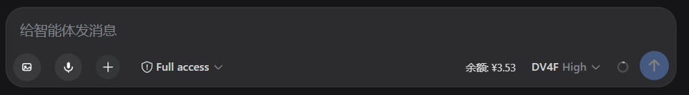
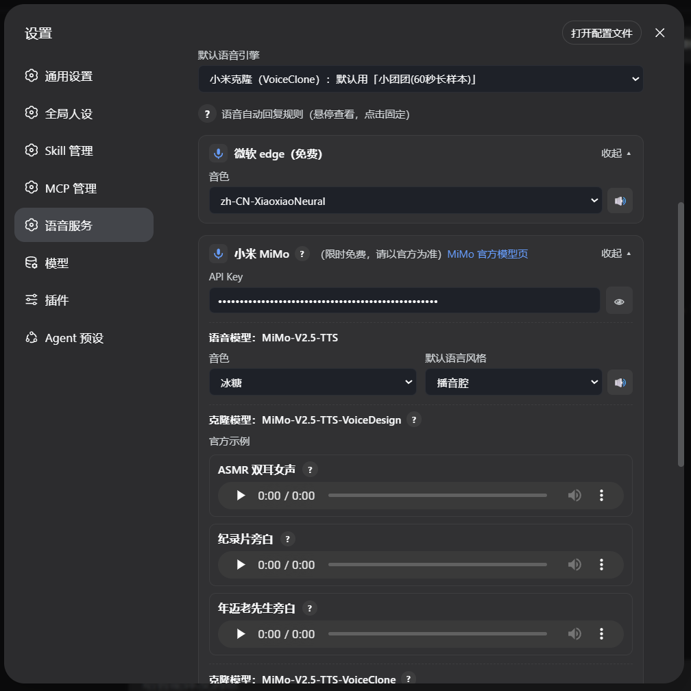
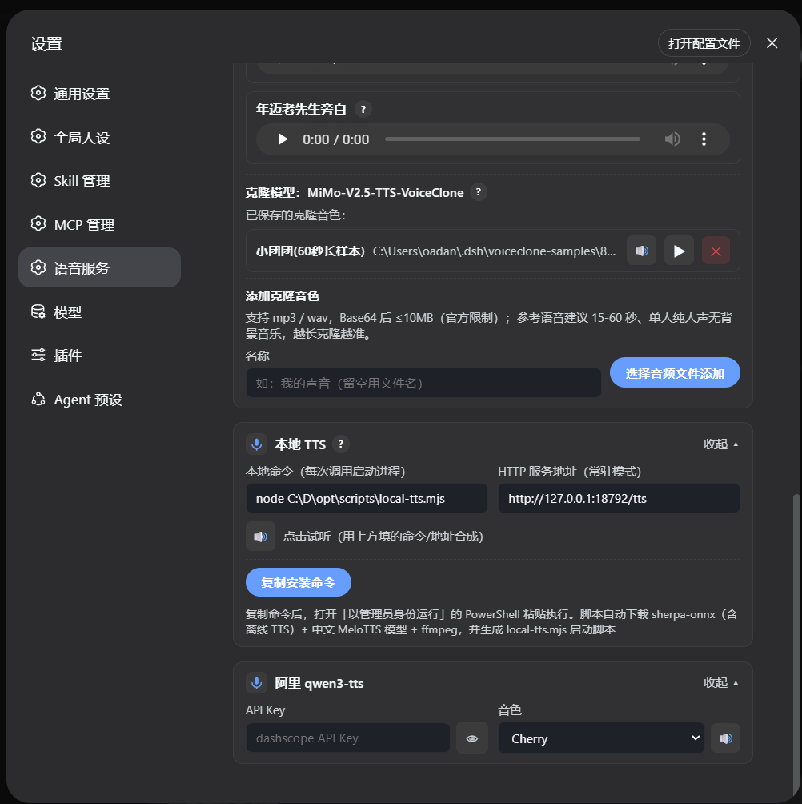
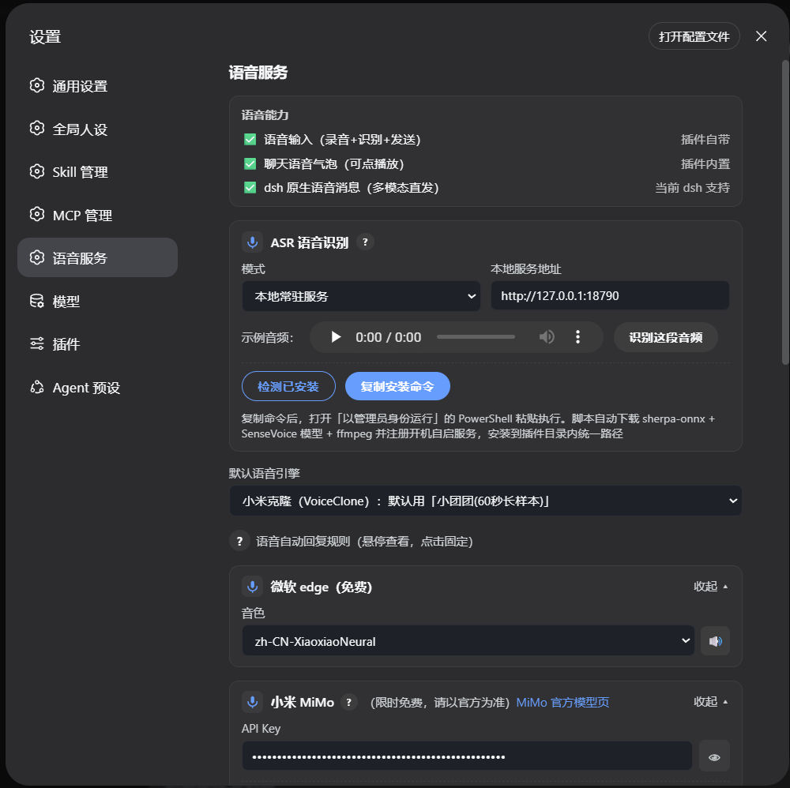
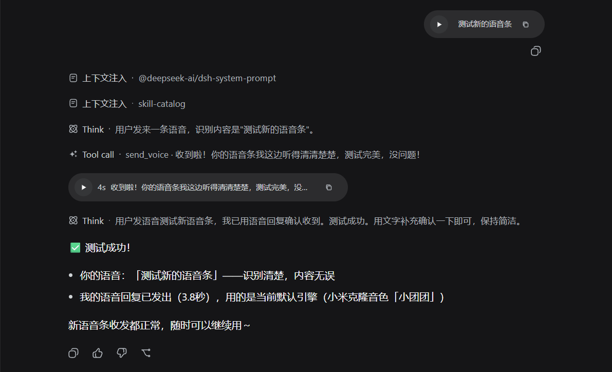

# dsh-input-tools —— DSH Web 多功能增强插件

> 一句话定位：**给 DSH 配上眼睛、耳朵和嘴巴——而且全部免费。**

给 DSH Web 加全套实用能力：**耳朵**（录音输入 / 离线 ASR）、**嘴巴**（多引擎 TTS / 音色克隆 / AI 语音回复）、**⚡ 提示词优化**、**/de 决策起草**、**余额与每轮花费**。看图不再需要插件代劳——所有在用模型都自带视觉。

- **host**（服务端）：语音工具 + TTS 六引擎 + ASR + 音色克隆 + 自动语音回复 + 提示词优化 + 每轮金额计算
- **client**（浏览器）：输入框工具条（图片/录音/⚡）+ 各设置分区 + 余额条 + 每轮消耗 pill
- **免费**：本地部署优先（离线 ASR / 本地 TTS），在线引擎也全是免费档，无需付费 Key

## 功能

### 语音
| 能力 | 说明 |
|---|---|
| 录音输入 | 输入框麦克风按钮，录音 → 本地 ASR 识别 → 发送 |
| TTS 六引擎 | auto / 小米 / 音色设计 / 音色克隆 / Edge(免费) / 本地 / 阿里 |
| 离线 ASR | 本地 sherpa-onnx 常驻服务（18790）或命令行模式，不依赖云 |
| 音色克隆 | 参考音频复刻音色，自带示例样本，开箱即用 |
| AI 语音回复 | 用户语音后 AI 自动用语音回（send_voice 工具） |
| 语音气泡 | 用户/AI 语音消息可点击播放，尾部复制转写文本 |

### 图片（2026-10-23 起由模型原生视觉承担，插件不再代劳）

- 输入框图片按钮上传 → 图片走官方附件管线直接交给模型，**由模型自带的视觉能力看图**
  （`deepseek-flash` 官方支持图像理解；agnes-text 等在线模型也支持识图）
- 🔴 **插件已移除 `look_image` 识图工具与「图片识别」设置分区**：
  原实现是「图转本地路径 → 让 AI 调工具 → 打本地视觉后端」，属于多余的一层。
  本地 ollama 的 `qwen3-vl:4b-instruct` 模型已卸载（省 3.1GB，ollama 服务也改为手动启动）。
- **反推生图提示词**改由生图侧承担：8090 的默认反推模型是 `agnes-text`。
  `reverse` / `text` 本质上就是「一套提示词 + 模型自带视觉」，不需要插件实现。

## 架构说明：哪些还需要改 dsh 源码（2026-09-26 全面复核，逐条核对代码）

> 🔴 **本节曾长期失实**：旧版写着"改 `llm-deepseek/serialize.ts`、`llm-pi-ai/context.ts`、`apiproxy/api-proxy.ts`"——经 `git diff dsh-v0.1.7-rc.2` 逐文件核对，**这三处在当前基线（官方 0.1.7-rc.2）已全部不存在**：官方原生了附件/图片管线（`attachment` + `llm-deepseek/files-api`），apiproxy 包整体退役。纯文本模型发图现走**插件零改动链路**：图片转本地附件路径文本 → AI 调 `look_image` 识图。

当前仍依赖 fork 源码的改动只剩**语音消息一簇**（官方无对应扩展点，进官方插件库前需上游化或找钩子）：

| 官方文件 | 改动 | 为什么暂时去不掉 |
|---|---|---|
| `core/session`（types + known-event-types） | `voice/reply`、`image/reply`、`video/reply` 三个 log-only 事件类型 | 事件白名单在 core，插件写入媒体事件目前必须经它 |
| `llm/llm/src/types.ts` + `content.ts`、`attachment` types/index | `VoiceBlock` 内容块类型 | 语音内容块的类型系统引用链 |
| `session/session-format-v2-to-v3/payload.ts` | voice 块迁移支持 | 同上迁移面 |
| `ui-chat` 包内新增（VoiceCard 等）+ 十余处小接线 | 语音气泡/图片条渲染 | **可迁插件**（视频条已在插件 client.js 用 `uiConversation.events.register` 纯插件渲染，语音照此办理即可归还）——待专项 |

另有五处**与媒体无关的通用健壮性补丁**（tailnet 域名信任、PWA 切后台重连、taskkill 全路径、nssm 下目录选择器走 browse、窄屏换行），各带 `[本地改造]` 注释，属"给官方报 bug/PR"的候选，不阻塞插件化。

**除上述外，本插件功能（设置分区/工具条/识图/余额/克隆/`/de`/⚡/每轮金额/插件页配置入口）全部走官方扩展点，0 改源码。** 设置分区的配置界面 2026-09-26 起已同时注册进官方「插件」页卡片详情（`plugins.bundle.config`），设置页旧分区为过渡期共存、随后移除。

当前分区（6 个）：语音服务 / 全局人设 / MCP 服务器 / Skill 管理 / 提示词优化 / 余额显示。
**「🧠 决策模型」与「图片识别」两个分区已于 2026-10-23 下线**（判断模型不再被任何链路需要；
识图交给模型原生视觉 + 生图侧 agnes-text）。组件定义均保留但不挂载。

### ⚡ 提示词优化 / `/de` 决策起草

| 能力 | 说明 |
|---|---|
| ⚡ 一键精炼 | 输入框 ⚡ 按钮：把口语草稿改写成可直接执行的任务描述（补参数、条理化、保留硬事实） |
| `/de` 决策起草 | 基于当前会话上下文，起草 3 条“你此刻可能想发出去的话”候选 |
| 模型来源 | **自动走 DSH 宿主的 LLM**（`ctx.llm.stream`），插件不碰 key、不写死地址 |
| 零配置 | 设置页可不选模型：默认跟随 App 默认模型；也可显式锁定某家（推荐锁死便宜档，见下） |
| 硬事实护栏 | 占位符 / 数字 / 禁令词丢失会重试并按原文退回，绝不静默改坏你的指令 |

**🔴 省钱建议**：在「提示词优化」分区把模型**显式锁定**到便宜档（如 `deepseek-account` / `deepseek-flash`）。
留空虽然会自动跟随，但 App 默认模型一旦被切成贵档（如 pro），⚡ 会跟着烧贵的。

配置存于 `~/.dsh/optimize-config.json`；逐条使用记录在 `~/.dsh/optimize-log.jsonl`。

### 每轮消耗金额（⚡¥ pill）

每条已定稿的回复尾部显示**本轮真实花费**（人民币，四位小数），例如 `⚡¥0.0896`。

| 项 | 口径 |
|---|---|
| 数据源 | DSH 会话事件里 `assistant/message.usage`（provider 侧精确 token 数） |
| 计价 | 未缓存输入 / 缓存命中输入 / 输出，三类分别按官方单价算（元/百万 token） |
| 时段 | 工作日 09:00-12:00、14:00-18:00 为高峰，其余空闲（空闲价为高峰一半） |
| 无记录 | 该轮没有 usage 时 **隐藏 pill**，不显示假值 |
| 接口 | `GET /api/turn-cost?sessionId=<id>`，不传 sessionId 时自动取最近活跃会话 |

> 实测对账：`87.48 - 0.0896 = 87.3904`，官方余额稳定在 87.39 —— pill 数值与余额差逐位一致。

### 余额

- 输入框右侧实时显示 **DeepSeek 账号余额**（¥）
- **余额向下截断到分**，不四舍五入：官方原始值 `88.29816262` 显示为 `88.29`（用 `toFixed` 会显示 88.30，多报 0.01）
- 支持多服务商通道（DeepSeek 账号 / API Key / 网关 / 火山方舟等），在「余额显示」分区配置

### 界面截图

**输入框工具条**（图片 + 录音 + 余额）：



**语音设置页 —— 小米 TTS**（三模型分区：TTS / 音色设计 / 音色克隆）：



**语音设置页 —— 本地 TTS 与阿里**：



**语音能力状态与 ASR 配置**：



**聊天语音消息展示**（用户/AI 语音气泡，可点击播放）：



## 本地 TTS（内置 Hojo-TTS-Light-40M）

语音设置页 → 本地 TTS → 点「复制安装命令」，拿**管理员 PowerShell** 粘贴执行 `scripts/install-local-tts.ps1`：

1. 从 HuggingFace 拉 **Hojo-TTS-Light-40M** 权重（4 个文件约 240MB；主站不通自动切 `hf-mirror.com`，断点续传 + 体积校验）
2. 建**专用瘦 venv**：只装 `onnxruntime` / `onnx` / `numpy` / `tokenizers` / `soundfile`，约 **170MB**
   （venv 与权重都**不进 git、不进安装包**，装机时本地自建）
3. 注册 nssm 常驻服务 `dsh-local-tts`（`127.0.0.1:18792`，开机自启，模型常驻内存）
4. **自检**：`GET /health` + 真合成一段 mp3，两关都过才报成功

装完 **地址由脚本自动写好**（`engines.local.url = http://127.0.0.1:18792/tts`；插件的配置按文件 mtime 实时重读，**不用重启**）；设置页可核对，「本地命令」留空。旧 MeloTTS 的 `cmd` 若还指着 `local-tts.mjs`，脚本会顺手清空（指向别处的自定义命令不动）。

| 细节 | 说明 |
|---|---|
| 落盘位置 | `%USERPROFILE%\.dsh\hojo-tts`（探测顺序：`-InstallDir` → `~\.dsh\hojo-tts` → `C:\D\opt\hojo-tts-light` → `D:\opt\hojo-tts-light`，已有安装复用，不重复占盘） |
| 服务端代码 | 在本插件内（`scripts/hojo-tts/`，含上游 Apache-2.0 的 `onnx_model.py` 与 LICENSE），安装时拷进安装目录 → **插件升级/重装不影响已装服务** |
| 常驻要求 | 服务以 LocalSystem 跑：脚本会把 `HOJO_MODELS` / `FFMPEG` 写进服务环境（注册表 `AppEnvironmentExtra`，`nssm set` 写多值不可靠），`server.py` 自身也有一套 ffmpeg 兜底探测 |
| 幂等 | 权重按最小体积校验、venv 按依赖 import 校验，缺什么补什么；`-Force` 重做，`-SkipService` 只装文件 |
| 旧版 MeloTTS | 已停用（sherpa-onnx VITS + `local-tts.mjs`）。脚本**只检测不自动删**残留，并打印删除命令——`sherpa-onnx` 本体与 `models\sensevoice-int8` 是 ASR 在用，别一起删 |

> 音色：40M 只有预置音色库（`hojo_zh_f_01/02` 中文女声 + 十几个英文男女），**无中文男声、无克隆接口**。要中文男声走小米音色设计。

## 安装

> ⚠️ **npm 注册表上的 0.3.24 是旧壳**（host 121KB/284KB、client 141KB/424KB 对不上本机补丁版），
> `dsh plugin add` 从注册表安装会**丢掉全部本地补丁**。在插件源码归位 git 仓库并重新发版之前，
> 本机/新装都只能用下面"整合版 fork"路径；本机 profile 内的包走 `link:` 指向
> `profiles/node_modules/@oadank/dsh-input-tools`，不受注册表影响。

### 场景一：已有 dsh 运行环境（源码版或 npm 版）

暂不可用（注册表是旧壳，见上方警告）。正确姿势：把本包目录整copy到
`~/.dsh/profiles/node_modules/@oadank/` 下，再 `dsh plugin --profile web add` 走 link（本机已如此）。

> ⚠️ **不要给本插件加回 `@deepseek-ai/*` 依赖**（例如 `@deepseek-ai/dsh-tools`）。核心包由宿主的运行环境提供，插件里 `import { defineTool } from '@deepseek-ai/dsh-tools'` 会顺着 profile 的 `node_modules` 解析到宿主那一份。
> 一旦写进 `dependencies`，pnpm 会把**另一个版本的核心包**（如 `dsh-tools@0.1.0-rc.8`）装进 profile，遮蔽宿主自己的同名插件行 —— 桌面客户端（0.2.0-rc.2）的版本闸门会直接禁用宿主自己的 `tools` 行（日志：`disabling profile plugin row "tools": Plugin @deepseek-ai/dsh-tools@0.1.0-rc.8 is incompatible with dsh 0.2.0-rc.2`），导致 `agent-loop` 等 11 个插件全部 pending、**整个客户端启动不了**。0.3.25 起该依赖已移除（2026-10-04 实测血案）。

### 场景二：从零开始（推荐，一键整合版）

整合版 fork 已内置语音改造 + 本插件 + 一键配置脚本：

```bash
git clone https://github.com/oadank/deepseek-harness.git
cd deepseek-harness
# Windows：
powershell -ExecutionPolicy Bypass -File scripts\setup-profile.ps1
# Linux/macOS：
bash scripts/setup-profile.sh
pnpm install
pnpm run build:lib       # ⚠️ 必须！全新 clone 无编译产物，跳过会报 Failed to resolve @deepseek-ai/dsh-client-web
pnpm run build:web
dsh --profile web
```

setup 脚本自动完成：装插件进 profile → 注册 → 检查 ffmpeg → 提示可选 ASR。**无需再执行 dsh plugin add**。

### 本地 ASR（语音转文字）

- **默认走官方内置（official 模式）**：dsh 客户端自带 SenseVoice 识别（`@deepseek-ai/dsh-experimental-voice-input-bundle`，运行时在 app.asar 内、模型在 `~\.dsh\speech-to-text\`，首次使用自动准备）——**零安装、零后台服务**，设置页选「官方内置」或点「检测语音识别」自动切换。
- 历史兼容：`本地常驻服务(18790)`/`本地命令` 两种旧模式仍可配置（第二套 sherpa 部署已退役，不再提供一键安装脚本）；也可用在线 API 模式。

### 依赖

- **ffmpeg**（语音转码必需）：Windows `winget install ffmpeg`；Linux `sudo apt install ffmpeg`
- **视觉能力**：2026-10-23 起**不需要任何视觉 MCP 或本地视觉服务**——图片由官方附件管线直接交给模型，
  由模型自带的图像理解看图。历史部署里的 `zai-vision` / `visionqa` / 本地 ollama 视觉模型都可移除。

## 配置

语音设置都在设置页「语音服务」分区（引擎、音色、Key、克隆、ASR 模式），存于 `~/.dsh/voice-config.json`。

## 语音消息渲染的归属（2026-09-26 定调）

语音气泡 / AI 语音回复条的**渲染代码正从官方仓库迁入本插件**（视频条已证明纯插件可行：`uiConversation.events.register` + 自绘组件，0 改官方源码）。迁移完成前，该渲染暂居 fork 的 `ui-chat` 包；完成后 fork 对官方源码的改动只剩 `core/session` 事件类型等无法插件化的少数项（见「架构说明」表）。

## 变更记录

### 2026-10-23
- **⚡ / `/de` 模型源固定为宿主 LLM**：模型清单与出字都走 `ctx.llm.stream`，插件不碰 key。
  配置改为显式锁定 `deepseek-account` / `deepseek-flash`（留空会自动跟随 App 默认模型，默认被切成贵档时会跟着烧钱）。
- **判断闸门关闭 + 「🧠 决策模型」设置分区下线**：`gateCheck=false`，`~/.dsh/decision-models.json` 清空。
  `/de` 改为盲起草（3 条候选照出，只少一截意图小抄）。
- **每轮消耗 pill 重建**：从「wb-shim 积分」改为「DeepSeek 官方单轮金额」，四位小数，读 DSH 会话里
  `assistant/message.usage` 的精确 token × 官方价目。无 usage 的轮次隐藏，不再显示 `—`。
- **余额显示修 `toFixed` 四舍五入**：改为向下截断到分（官方 `88.29816262` → 显示 `88.29`，原来显示 88.30 多报 0.01）。
- **wb-shim 全线停用**：原 `/api/turn-usage`、`/api/conv-ids` 及积分通道依赖的 WorkBuddy 网关已下线，
  相关代码保留但不再被主链路调用；余额与每轮金额都改走 DeepSeek 官方口径。

### 2026-10-08
- 「🧠 决策模型」登记表（`decision-models.json`）：自填地址/key/模型名，与 DSH 大模型列表解耦。
- 余额显示分区扩展多服务商通道。
